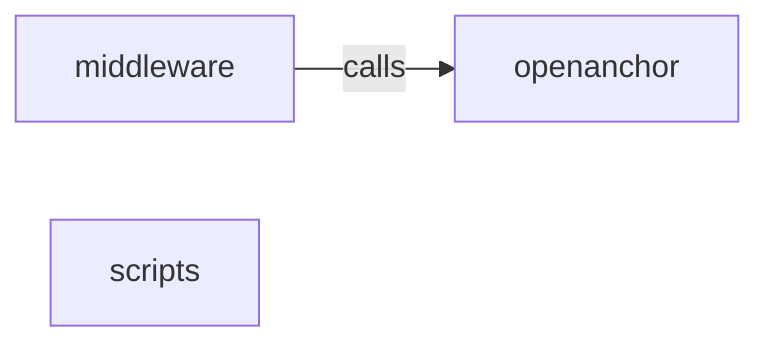

_Generated by CodeAtlas._

## Details

Owns 278 symbols across 19 file(s).

### middleware

Owns 19 symbols across 2 file(s).

**Related Classes/Methods:** _None_

**Source Files:**

- `openanchor/middleware/langchain.py`
  - `openanchor.middleware.langchain.OpenAnchorMiddleware`
  - `openanchor.middleware.langchain.OpenAnchorMiddleware.__call__`
  - `openanchor.middleware.langchain.OpenAnchorMiddleware.__init__`
  - `openanchor.middleware.langchain.OpenAnchorMiddleware._summarize_content`
  - `openanchor.middleware.langchain.OpenAnchorMiddleware._wrap_runnable`
  - `openanchor.middleware.langchain.OpenAnchorMiddleware._wrap_runnable.WrappedRunnable`
  - `openanchor.middleware.langchain.OpenAnchorMiddleware._wrap_runnable.WrappedRunnable.__init__`
  - `openanchor.middleware.langchain.OpenAnchorMiddleware._wrap_runnable.WrappedRunnable._get_model_name`
  - `openanchor.middleware.langchain.OpenAnchorMiddleware._wrap_runnable.WrappedRunnable.batch`
  - `openanchor.middleware.langchain.OpenAnchorMiddleware._wrap_runnable.WrappedRunnable.invoke`
  - `openanchor.middleware.langchain.OpenAnchorMiddleware._wrap_runnable.WrappedRunnable.stream`
  - `openanchor.middleware.langchain.OpenAnchorMiddleware.capture_llm_call`
  - `openanchor.middleware.langchain.OpenAnchorMiddleware.get_problematic_calls`
  - `openanchor.middleware.langchain.OpenAnchorMiddleware.get_recommendations`
  - `openanchor.middleware.langchain.OpenAnchorMiddleware.get_session_stats`
  - `openanchor.middleware.langchain.OpenAnchorMiddleware.get_summary`
  - `openanchor.middleware.langchain.OpenAnchorMiddleware.get_tokens_by_operation`
  - `openanchor.middleware.langchain.OpenAnchorMiddleware.get_tokens_by_phase`
  - `openanchor.middleware.langchain.OpenAnchorMiddleware.rank_prompts_by_efficiency`

### scripts

Owns 1 symbols across 3 file(s).

**Related Classes/Methods:** _None_

**Source Files:**

- `openanchor/scripts/post_install.py`
  - `openanchor.scripts.post_install.post_install`
