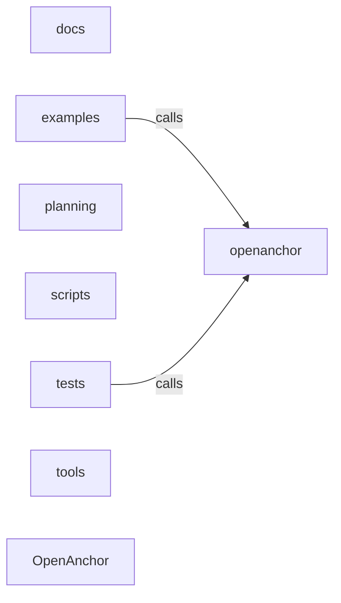

_Generated by CodeAtlas._

## Details

Architecture map of OpenAnchor.

### docs

Owns 0 symbols across 5 file(s).

**Related Classes/Methods:** _None_

### examples

Owns 2 symbols across 2 file(s).

**Related Classes/Methods:** _None_

**Source Files:**

- `examples/basic_usage.py`
  - `examples.basic_usage.main`
- `examples/mcp_openanchor.py`
  - `examples.mcp_openanchor.main`

### openanchor

Owns 278 symbols across 19 file(s).

**Related Classes/Methods:** _None_

**Source Files:**

- `openanchor/__main__.py`
  - `openanchor.__main__._HealthHandler`
  - `openanchor.__main__._HealthHandler._write_json`
  - `openanchor.__main__._HealthHandler.do_GET`
  - `openanchor.__main__._HealthHandler.log_message`
  - `openanchor.__main__._cmd_health`
  - `openanchor.__main__._cmd_serve`
  - `openanchor.__main__._cmd_version`
  - `openanchor.__main__._health_payload`
  - `openanchor.__main__.build_parser`
  - `openanchor.__main__.main`
- `openanchor/_mcp_connector.py`
  - `openanchor._mcp_connector.BaseMCPConnector`
  - `openanchor._mcp_connector.BaseMCPConnector.__init__`
  - `openanchor._mcp_connector.BaseMCPConnector._generate_dab_config`
  - `openanchor._mcp_connector.BaseMCPConnector._start_dab_subprocess`
  - `openanchor._mcp_connector.BaseMCPConnector._write_temp_config`
  - `openanchor._mcp_connector.BaseMCPConnector.get_mcp_tools`
  - `openanchor._mcp_connector.BaseMCPConnector.get_tool_handlers`
  - `openanchor._mcp_connector.BaseMCPConnector.is_ready`
  - `openanchor._mcp_connector.BaseMCPConnector.start_mcp_connector`
  - `openanchor._mcp_connector.BaseMCPConnector.stop_mcp_connector`
  - `openanchor._mcp_connector.SemanticCache`
  - `openanchor._mcp_connector.SemanticCache.__init__`
  - `openanchor._mcp_connector.SemanticCache.start_mcp_connector`
  - `openanchor._mcp_connector.SemanticCache.stop_mcp_connector`
  - `openanchor._mcp_connector._MCPAnchorConnector`
  - `openanchor._mcp_connector._MCPAnchorConnector.__init__`
  - `openanchor._mcp_connector._MCPAnchorConnector._generate_dab_config`
  - `openanchor._mcp_connector._MCPAnchorConnector.get_mcp_tools`
  - `openanchor._mcp_connector._MCPAnchorConnector.get_tool_handlers`
- `openanchor/_mcp_tools.py`
  - `openanchor._mcp_tools.OpenAnchorMCPHandler`
  - `openanchor._mcp_tools.OpenAnchorMCPHandler.__init__`
  - `openanchor._mcp_tools.OpenAnchorMCPHandler.analyze_cache_hit_rate`
  - `openanchor._mcp_tools.OpenAnchorMCPHandler.attribute_token_cost`
  - `openanchor._mcp_tools.OpenAnchorMCPHandler.batch_cache_prompts`
  - `openanchor._mcp_tools.OpenAnchorMCPHandler.cache_prompt_embedding`
  - `openanchor._mcp_tools.OpenAnchorMCPHandler.estimate_token_usage`
  - `openanchor._mcp_tools.OpenAnchorMCPHandler.export_cache_manifest`
  - `openanchor._mcp_tools.OpenAnchorMCPHandler.find_cached_similar`
  - `openanchor._mcp_tools.OpenAnchorMCPHandler.get_cache_statistics`
  - `openanchor._mcp_tools.OpenAnchorMCPHandler.invalidate_cache_entries`
  - `openanchor._mcp_tools.OpenAnchorMCPHandler.measure_cache_efficiency`
  - `openanchor._mcp_tools.OpenAnchorMCPHandler.optimize_for_caching`
  - `openanchor._mcp_tools.OpenAnchorMCPHandler.predict_cache_savings`
  - `openanchor._mcp_tools.OpenAnchorMCPTools`
  - `openanchor._mcp_tools.OpenAnchorMCPTools.get_tools`
  - `openanchor._mcp_tools._estimate_tokens`
- `openanchor/analytics.py`
  - `openanchor.analytics.Analytics`
  - `openanchor.analytics.Analytics.__init__`
  - `openanchor.analytics.Analytics.compare_sessions`
  - `openanchor.analytics.Analytics.get_all_sessions`
  - `openanchor.analytics.Analytics.get_call_stats`
  - `openanchor.analytics.Analytics.get_latency_stats`
  - `openanchor.analytics.Analytics.get_problematic_calls`
  - `openanchor.analytics.Analytics.get_prompt_stats`
  - `openanchor.analytics.Analytics.get_quality_stats`
  - `openanchor.analytics.Analytics.get_session_stats`
  - `openanchor.analytics.Analytics.get_summary`
  - `openanchor.analytics.Analytics.get_tokens_by_day`
  - `openanchor.analytics.Analytics.get_tokens_by_hour`
  - `openanchor.analytics.Analytics.get_tokens_by_model`
  - `openanchor.analytics.Analytics.get_tokens_by_operation`
  - `openanchor.analytics.Analytics.get_tokens_by_phase`
  - `openanchor.analytics.Analytics.get_tokens_by_prompt_template`
  - `openanchor.analytics.Analytics.rank_prompts_by_efficiency`
- `openanchor/attribution.py`
  - `openanchor.attribution.AttributionModel`
  - `openanchor.attribution.AttributionModel.__init__`
  - `openanchor.attribution.AttributionModel.analyze_call`
  - `openanchor.attribution.AttributionModel.get_attribution_summary`
  - `openanchor.attribution.AttributionModel.get_model_distribution`
  - `openanchor.attribution.AttributionModel.get_operation_breakdown`
  - `openanchor.attribution.AttributionModel.get_phase_breakdown`
  - `openanchor.attribution.AttributionModel.get_prompt_efficiency`
  - `openanchor.attribution.AttributionModel.rank_prompts_by_efficiency`
- `openanchor/attribution_6d.py`
  - `openanchor.attribution_6d.Attribution6D`
  - `openanchor.attribution_6d.Attribution6D.cost_per_token`
  - `openanchor.attribution_6d.Attribution6D.to_dict`
  - `openanchor.attribution_6d.Attribution6D.tokens_per_second`
  - `openanchor.attribution_6d.Attribution6D.total_tokens`
  - `openanchor.attribution_6d.Attribution6DAnalyzer`
  - `openanchor.attribution_6d.Attribution6DAnalyzer.__init__`
  - `openanchor.attribution_6d.Attribution6DAnalyzer.get_anomalies`
  - `openanchor.attribution_6d.Attribution6DAnalyzer.get_dimension_stats`
  - `openanchor.attribution_6d.Attribution6DAnalyzer.get_model_comparison`
  - `openanchor.attribution_6d.Attribution6DAnalyzer.get_operation_breakdown`
  - `openanchor.attribution_6d.Attribution6DAnalyzer.get_quality_efficiency_matrix`
  - `openanchor.attribution_6d.Attribution6DAnalyzer.get_summary`
  - `openanchor.attribution_6d.Attribution6DAnalyzer.record_call`
  - `openanchor.attribution_6d.Quality`
- `openanchor/collector.py`
  - `openanchor.collector.TokenCollector`
  - `openanchor.collector.TokenCollector.__init__`
  - `openanchor.collector.TokenCollector.capture_event`
  - `openanchor.collector.TokenCollector.compute_call_stats`
  - `openanchor.collector.TokenCollector.compute_session_stats`
  - `openanchor.collector.TokenCollector.get_all_events`
  - `openanchor.collector.TokenCollector.get_events_for_call`
  - `openanchor.collector.TokenCollector.get_events_for_session`
  - `openanchor.collector.TokenCollector.set_session`
- `openanchor/federated_learning.py`
  - `openanchor.federated_learning.AggregatedModel`
  - `openanchor.federated_learning.FederatedLearner`
  - `openanchor.federated_learning.FederatedLearner.__init__`
  - `openanchor.federated_learning.FederatedLearner._calculate_convergence`
  - `openanchor.federated_learning.FederatedLearner._initialize_agents`
  - `openanchor.federated_learning.FederatedLearner.aggregate_gradients`
  - `openanchor.federated_learning.FederatedLearner.broadcast_global_model`
  - `openanchor.federated_learning.FederatedLearner.compute_local_gradients`
  - `openanchor.federated_learning.FederatedLearner.federated_training_round`
  - `openanchor.federated_learning.FederatedLearner.get_fleet_statistics`
  - `openanchor.federated_learning.FederatedLearner.get_model_drift`
  - `openanchor.federated_learning.FederatedLearner.update_global_model`
  - `openanchor.federated_learning.FederatedOptimizer`
  - `openanchor.federated_learning.FederatedOptimizer.__init__`
  - `openanchor.federated_learning.FederatedOptimizer.adaptive_learning_rate`
  - `openanchor.federated_learning.FederatedOptimizer.calculate_communication_cost`
  - `openanchor.federated_learning.FederatedOptimizer.get_optimization_report`
  - `openanchor.federated_learning.GradientUpdate`
  - `openanchor.federated_learning.LocalModel`
  - `openanchor.federated_learning.LocalModel.__init__`
  - `openanchor.federated_learning.LocalModel.local_accuracy`
  - `openanchor.federated_learning.LocalModel.update_from_global`
- `openanchor/model_evolution.py`
  - `openanchor.model_evolution.AdaptiveHyperparameterTuner`
  - `openanchor.model_evolution.AdaptiveHyperparameterTuner.__init__`
  - `openanchor.model_evolution.AdaptiveHyperparameterTuner.apply_suggestion`
  - `openanchor.model_evolution.AdaptiveHyperparameterTuner.get_statistics`
  - `openanchor.model_evolution.AdaptiveHyperparameterTuner.get_suggestions`
  - `openanchor.model_evolution.GridSearchOptimizer`
  - `openanchor.model_evolution.GridSearchOptimizer.__init__`
  - `openanchor.model_evolution.GridSearchOptimizer.estimate_search_cost`
  - `openanchor.model_evolution.GridSearchOptimizer.get_best_params`
  - `openanchor.model_evolution.GridSearchOptimizer.get_statistics`
  - `openanchor.model_evolution.GridSearchOptimizer.get_total_combinations`
  - `openanchor.model_evolution.GridSearchOptimizer.record_result`
  - `openanchor.model_evolution.GridSearchOptimizer.set_param_grid`
  - `openanchor.model_evolution.HyperparameterSuggestion`
  - `openanchor.model_evolution.ModelCheckpoint`
  - `openanchor.model_evolution.ModelEvolutionTracker`
  - `openanchor.model_evolution.ModelEvolutionTracker.__init__`
  - `openanchor.model_evolution.ModelEvolutionTracker.add_checkpoint`
  - `openanchor.model_evolution.ModelEvolutionTracker.get_improvement_rate`
  - `openanchor.model_evolution.ModelEvolutionTracker.has_plateau`
  - `openanchor.model_evolution.ModelSelector`
  - `openanchor.model_evolution.ModelSelector.__init__`
  - `openanchor.model_evolution.ModelSelector.add_model`
  - `openanchor.model_evolution.ModelSelector.get_ensemble_weights`
  - `openanchor.model_evolution.ModelSelector.get_statistics`
  - `openanchor.model_evolution.ModelSelector.select_best`
- `openanchor/models.py`
  - `openanchor.models.Attribution`
  - `openanchor.models.Attribution.to_dict`
  - `openanchor.models.OperationType`
  - `openanchor.models.RequestPhase`
  - `openanchor.models.SessionStats`
  - `openanchor.models.SessionStats.duration_seconds`
  - `openanchor.models.SessionStats.to_dict`
  - `openanchor.models.SessionStats.total_tokens`
  - `openanchor.models.TokenConsumption`
  - `openanchor.models.TokenConsumption.total_tokens`
  - `openanchor.models.TokenEvent`
  - `openanchor.models.TokenEvent.to_dict`
- `openanchor/multi_agent_optimization.py`
  - `openanchor.multi_agent_optimization.AgentProfile`
  - `openanchor.multi_agent_optimization.FleetOptimizationEngine`
  - `openanchor.multi_agent_optimization.FleetOptimizationEngine.__init__`
  - `openanchor.multi_agent_optimization.FleetOptimizationEngine.get_optimization_report`
  - `openanchor.multi_agent_optimization.FleetOptimizationEngine.set_optimization_targets`
  - `openanchor.multi_agent_optimization.FleetOptimizationEngine.simulate_fleet_optimization`
  - `openanchor.multi_agent_optimization.MultiAgentCoordinator`
  - `openanchor.multi_agent_optimization.MultiAgentCoordinator.__init__`
  - `openanchor.multi_agent_optimization.MultiAgentCoordinator._calculate_collaboration_density`
  - `openanchor.multi_agent_optimization.MultiAgentCoordinator._calculate_pattern_relevance`
  - `openanchor.multi_agent_optimization.MultiAgentCoordinator._initialize_agents`
  - `openanchor.multi_agent_optimization.MultiAgentCoordinator.add_agent`
  - `openanchor.multi_agent_optimization.MultiAgentCoordinator.adopt_knowledge`
  - `openanchor.multi_agent_optimization.MultiAgentCoordinator.coordinate_optimization`
  - `openanchor.multi_agent_optimization.MultiAgentCoordinator.detect_collaboration_bottlenecks`
  - `openanchor.multi_agent_optimization.MultiAgentCoordinator.get_fleet_statistics`
  - `openanchor.multi_agent_optimization.MultiAgentCoordinator.get_top_performers`
  - `openanchor.multi_agent_optimization.MultiAgentCoordinator.share_optimization_pattern`
  - `openanchor.multi_agent_optimization.MultiAgentCoordinator.transfer_expertise`
  - `openanchor.multi_agent_optimization.SharedKnowledge`
- `openanchor/okf_cost_governance.py`
  - `openanchor.okf_cost_governance.BudgetPolicy`
  - `openanchor.okf_cost_governance.CostAnomaly`
  - `openanchor.okf_cost_governance.OKFCostGovernance`
  - `openanchor.okf_cost_governance.OKFCostGovernance.__init__`
  - `openanchor.okf_cost_governance.OKFCostGovernance._calculate_baseline`
  - `openanchor.okf_cost_governance.OKFCostGovernance._get_historical_costs`
  - `openanchor.okf_cost_governance.OKFCostGovernance.detect_anomaly`
  - `openanchor.okf_cost_governance.OKFCostGovernance.get_cost_forecast`
  - `openanchor.okf_cost_governance.OKFCostGovernance.record_spend`
  - `openanchor.okf_cost_governance.OKFCostGovernance.set_budget`
- `openanchor/okf_optimization_tracking.py`
  - `openanchor.okf_optimization_tracking.OKFOptimizationTracking`
  - `openanchor.okf_optimization_tracking.OKFOptimizationTracking.__init__`
  - `openanchor.okf_optimization_tracking.OKFOptimizationTracking._get_results_for_model_domain`
  - `openanchor.okf_optimization_tracking.OKFOptimizationTracking.get_strategy_effectiveness`
  - `openanchor.okf_optimization_tracking.OKFOptimizationTracking.recommend_optimizations`
  - `openanchor.okf_optimization_tracking.OKFOptimizationTracking.record_optimization`
  - `openanchor.okf_optimization_tracking.OptimizationLeaderboard`
  - `openanchor.okf_optimization_tracking.OptimizationLeaderboard.__init__`
  - `openanchor.okf_optimization_tracking.OptimizationLeaderboard.get_best_strategies`
  - `openanchor.okf_optimization_tracking.OptimizationResult`
- `openanchor/okf_token_profiles.py`
  - `openanchor.okf_token_profiles.OKFTokenProfileCatalog`
  - `openanchor.okf_token_profiles.OKFTokenProfileCatalog.__init__`
  - `openanchor.okf_token_profiles.OKFTokenProfileCatalog.get_model_efficiency`
  - `openanchor.okf_token_profiles.OKFTokenProfileCatalog.get_profile`
  - `openanchor.okf_token_profiles.OKFTokenProfileCatalog.save_profile`
  - `openanchor.okf_token_profiles.TokenProfile`
  - `openanchor.okf_token_profiles.TokenProfileAnalyzer`
  - `openanchor.okf_token_profiles.TokenProfileAnalyzer.estimate_cost`
  - `openanchor.okf_token_profiles.TokenProfileAnalyzer.recommend_model`
- `openanchor/otel.py`
  - `openanchor.otel._maybe_autoconfigure_from_env`
  - `openanchor.otel.configure_tracing`
  - `openanchor.otel.configured_exporter`
  - `openanchor.otel.disable_tracing`
  - `openanchor.otel.get_tracer`
  - `openanchor.otel.is_otel_available`
  - `openanchor.otel.is_tracing_configured`
  - `openanchor.otel.start_span`
- `openanchor/privacy.py`
  - `openanchor.privacy.hash_content`
  - `openanchor.privacy.redact_pii`
  - `openanchor.privacy.summarize_captured_content`
- `openanchor/semantic_cache.py`
  - `openanchor.semantic_cache.CacheMatch`
  - `openanchor.semantic_cache.CacheMatch.to_dict`
  - `openanchor.semantic_cache.EmbeddingProvider`
  - `openanchor.semantic_cache.EmbeddingProvider.dimension`
  - `openanchor.semantic_cache.EmbeddingProvider.embed`
  - `openanchor.semantic_cache.EmbeddingProvider.name`
  - `openanchor.semantic_cache.HashingEmbeddingProvider`
  - `openanchor.semantic_cache.HashingEmbeddingProvider.__init__`
  - `openanchor.semantic_cache.HashingEmbeddingProvider.dimension`
  - `openanchor.semantic_cache.HashingEmbeddingProvider.embed`
  - `openanchor.semantic_cache.OllamaEmbeddingProvider`
  - `openanchor.semantic_cache.OllamaEmbeddingProvider.__init__`
  - `openanchor.semantic_cache.OllamaEmbeddingProvider.dimension`
  - `openanchor.semantic_cache.OllamaEmbeddingProvider.embed`
  - `openanchor.semantic_cache.OllamaEmbeddingProvider.is_reachable`
  - `openanchor.semantic_cache.SemanticCacheStore`
  - `openanchor.semantic_cache.SemanticCacheStore.__init__`
  - `openanchor.semantic_cache.SemanticCacheStore._init_db`
  - `openanchor.semantic_cache.SemanticCacheStore._live_entries`
  - `openanchor.semantic_cache.SemanticCacheStore._record_hits`
  - `openanchor.semantic_cache.SemanticCacheStore._record_lookup`
  - `openanchor.semantic_cache.SemanticCacheStore.clear`
  - `openanchor.semantic_cache.SemanticCacheStore.close`
  - `openanchor.semantic_cache.SemanticCacheStore.count_entries`
  - `openanchor.semantic_cache.SemanticCacheStore.estimated_size_bytes`
  - `openanchor.semantic_cache.SemanticCacheStore.export_entries`
  - `openanchor.semantic_cache.SemanticCacheStore.find_similar`
  - `openanchor.semantic_cache.SemanticCacheStore.invalidate`
  - `openanchor.semantic_cache.SemanticCacheStore.lookup_stats`
  - `openanchor.semantic_cache.SemanticCacheStore.purge_expired`
  - `openanchor.semantic_cache.SemanticCacheStore.put`
  - `openanchor.semantic_cache._now`
  - `openanchor.semantic_cache.cosine_similarity`
  - `openanchor.semantic_cache.default_embedder`
- `openanchor/storage.py`
  - `openanchor.storage.EventStore`
  - `openanchor.storage.EventStore.__init__`
  - `openanchor.storage.EventStore.add_attribution`
  - `openanchor.storage.EventStore.add_event`
  - `openanchor.storage.EventStore.all_events`
  - `openanchor.storage.EventStore.clear`
  - `openanchor.storage.EventStore.get_attribution`
  - `openanchor.storage.EventStore.get_event`
  - `openanchor.storage.EventStore.get_events_by_call`
  - `openanchor.storage.EventStore.get_events_by_session`
  - `openanchor.storage.EventStore.get_events_by_timerange`
  - `openanchor.storage.EventStore.purge_older_than`
  - `openanchor.storage.SqliteEventStore`
  - `openanchor.storage.SqliteEventStore.__init__`
  - `openanchor.storage.SqliteEventStore._init_db`
  - `openanchor.storage.SqliteEventStore._row_to_event`
  - `openanchor.storage.SqliteEventStore.add_attribution`
  - `openanchor.storage.SqliteEventStore.add_event`
  - `openanchor.storage.SqliteEventStore.all_events`
  - `openanchor.storage.SqliteEventStore.clear`
  - `openanchor.storage.SqliteEventStore.close`
  - `openanchor.storage.SqliteEventStore.get_attribution`
  - `openanchor.storage.SqliteEventStore.get_event`
  - `openanchor.storage.SqliteEventStore.get_events_by_call`
  - `openanchor.storage.SqliteEventStore.get_events_by_session`
  - `openanchor.storage.SqliteEventStore.get_events_by_timerange`
  - `openanchor.storage.SqliteEventStore.purge_expired`

### planning

Owns 0 symbols across 28 file(s).

**Related Classes/Methods:** _None_

### scripts

Owns 0 symbols across 2 file(s).

**Related Classes/Methods:** _None_

### tests

Owns 345 symbols across 16 file(s).

**Related Classes/Methods:** _None_

**Source Files:**

- `tests/test_attribution_6d.py`
  - `tests.test_attribution_6d.TestAttribution6D`
  - `tests.test_attribution_6d.TestAttribution6D.test_attribution_creation`
  - `tests.test_attribution_6d.TestAttribution6D.test_cost_per_token_calculation`
  - `tests.test_attribution_6d.TestAttribution6D.test_throughput_calculation`
  - `tests.test_attribution_6d.TestAttribution6D.test_to_dict_serialization`
  - `tests.test_attribution_6d.TestAttribution6DAnalyzer`
  - `tests.test_attribution_6d.TestAttribution6DAnalyzer.test_anomaly_detection`
  - `tests.test_attribution_6d.TestAttribution6DAnalyzer.test_dimension_stats_tokens`
  - `tests.test_attribution_6d.TestAttribution6DAnalyzer.test_model_comparison`
  - `tests.test_attribution_6d.TestAttribution6DAnalyzer.test_operation_breakdown`
  - `tests.test_attribution_6d.TestAttribution6DAnalyzer.test_quality_efficiency_matrix`
  - `tests.test_attribution_6d.TestAttribution6DAnalyzer.test_summary_report`
- `tests/test_codeatlas_adapter.py`
  - `tests.test_codeatlas_adapter._run`
  - `tests.test_codeatlas_adapter.test_check_reports_the_embedded_engine_available`
  - `tests.test_codeatlas_adapter.test_diagnose_summarises_the_architecture_map`
  - `tests.test_codeatlas_adapter.test_explain_reports_an_unknown_node_as_an_error`
  - `tests.test_codeatlas_adapter.test_god_nodes_are_ranked_by_degree`
- `tests/test_core.py`
  - `tests.test_core.TestAnalytics`
  - `tests.test_core.TestAnalytics.test_get_problematic_calls`
  - `tests.test_core.TestAnalytics.test_get_summary`
  - `tests.test_core.TestAnalytics.test_get_tokens_by_operation`
  - `tests.test_core.TestAnalytics.test_get_tokens_by_phase`
  - `tests.test_core.TestAttributionModel`
  - `tests.test_core.TestAttributionModel.test_analyze_call_multiple_operations`
  - `tests.test_core.TestAttributionModel.test_analyze_call_simple`
  - `tests.test_core.TestAttributionModel.test_get_operation_breakdown`
  - `tests.test_core.TestAttributionModel.test_rank_prompts_by_efficiency`
  - `tests.test_core.TestTokenCollector`
  - `tests.test_core.TestTokenCollector.test_capture_event`
  - `tests.test_core.TestTokenCollector.test_capture_multiple_events`
  - `tests.test_core.TestTokenCollector.test_compute_call_stats`
  - `tests.test_core.TestTokenCollector.test_compute_session_stats`
  - `tests.test_core.TestTokenCollector.test_get_events_by_session`
  - `tests.test_core.TestTokenEvent`
  - `tests.test_core.TestTokenEvent.test_create_event`
  - `tests.test_core.TestTokenEvent.test_event_to_dict`
- `tests/test_federated_learning.py`
  - `tests.test_federated_learning.TestAggregatedModel`
  - `tests.test_federated_learning.TestAggregatedModel.test_aggregated_model_convergence`
  - `tests.test_federated_learning.TestAggregatedModel.test_aggregated_model_creation`
  - `tests.test_federated_learning.TestFederatedLearner`
  - `tests.test_federated_learning.TestFederatedLearner.test_aggregate_gradients`
  - `tests.test_federated_learning.TestFederatedLearner.test_broadcast_global_model`
  - `tests.test_federated_learning.TestFederatedLearner.test_calculate_convergence`
  - `tests.test_federated_learning.TestFederatedLearner.test_compute_local_gradients`
  - `tests.test_federated_learning.TestFederatedLearner.test_federated_training_round`
  - `tests.test_federated_learning.TestFederatedLearner.test_get_fleet_statistics`
  - `tests.test_federated_learning.TestFederatedLearner.test_get_model_drift`
  - `tests.test_federated_learning.TestFederatedLearner.test_learner_initialization`
  - `tests.test_federated_learning.TestFederatedLearner.test_update_global_model`
  - `tests.test_federated_learning.TestFederatedLearningIntegration`
  - `tests.test_federated_learning.TestFederatedLearningIntegration.test_agent_dropout_resilience`
  - `tests.test_federated_learning.TestFederatedLearningIntegration.test_convergence_over_rounds`
  - `tests.test_federated_learning.TestFederatedLearningIntegration.test_full_training_workflow`
  - `tests.test_federated_learning.TestFederatedLearningIntegration.test_heterogeneous_data`
  - `tests.test_federated_learning.TestFederatedLearningIntegration.test_model_personalization`
  - `tests.test_federated_learning.TestFederatedOptimizer`
  - `tests.test_federated_learning.TestFederatedOptimizer.test_adaptive_learning_rate`
  - `tests.test_federated_learning.TestFederatedOptimizer.test_calculate_communication_cost`
  - `tests.test_federated_learning.TestFederatedOptimizer.test_get_optimization_report`
  - `tests.test_federated_learning.TestFederatedOptimizer.test_optimizer_initialization`
  - `tests.test_federated_learning.TestGradientUpdate`
  - `tests.test_federated_learning.TestGradientUpdate.test_gradient_update_attributes`
  - `tests.test_federated_learning.TestGradientUpdate.test_gradient_update_creation`
  - `tests.test_federated_learning.TestLocalModel`
  - `tests.test_federated_learning.TestLocalModel.test_local_accuracy`
  - `tests.test_federated_learning.TestLocalModel.test_local_model_creation`
  - `tests.test_federated_learning.TestLocalModel.test_local_model_update_from_global`
- `tests/test_langchain_middleware.py`
  - `tests.test_langchain_middleware.TestOpenAnchorMiddleware`
  - `tests.test_langchain_middleware.TestOpenAnchorMiddleware.test_capture_multiple_calls`
  - `tests.test_langchain_middleware.TestOpenAnchorMiddleware.test_get_problematic_calls`
  - `tests.test_langchain_middleware.TestOpenAnchorMiddleware.test_get_recommendations_high_tokens`
  - `tests.test_langchain_middleware.TestOpenAnchorMiddleware.test_get_recommendations_low_quality`
  - `tests.test_langchain_middleware.TestOpenAnchorMiddleware.test_get_summary`
  - `tests.test_langchain_middleware.TestOpenAnchorMiddleware.test_get_tokens_by_operation`
  - `tests.test_langchain_middleware.TestOpenAnchorMiddleware.test_get_tokens_by_phase`
  - `tests.test_langchain_middleware.TestOpenAnchorMiddleware.test_manual_capture_llm_call`
  - `tests.test_langchain_middleware.TestOpenAnchorMiddleware.test_middleware_initialization`
  - `tests.test_langchain_middleware.TestOpenAnchorMiddleware.test_rank_prompts_by_efficiency`
  - `tests.test_langchain_middleware.TestWrappedRunnableInvoke`
  - `tests.test_langchain_middleware.TestWrappedRunnableInvoke.test_batch_invokes_each_input`
  - `tests.test_langchain_middleware.TestWrappedRunnableInvoke.test_call_requires_a_runnable`
  - `tests.test_langchain_middleware.TestWrappedRunnableInvoke.test_invoke_captures_a_token_event`
  - `tests.test_langchain_middleware.TestWrappedRunnableInvoke.test_invoke_defaults_to_no_raw_content_capture`
  - `tests.test_langchain_middleware.TestWrappedRunnableInvoke.test_invoke_extracts_model_name_from_dict_input`
  - `tests.test_langchain_middleware.TestWrappedRunnableInvoke.test_invoke_falls_back_to_unknown_model_for_non_dict_input`
  - `tests.test_langchain_middleware.TestWrappedRunnableInvoke.test_invoke_opt_in_raw_capture_redacts_pii_by_default`
  - `tests.test_langchain_middleware.TestWrappedRunnableInvoke.test_invoke_opt_in_raw_capture_without_redaction`
  - `tests.test_langchain_middleware.TestWrappedRunnableInvoke.test_invoke_propagates_runnable_exceptions`
  - `tests.test_langchain_middleware.TestWrappedRunnableInvoke.test_invoke_propagates_runnable_exceptions._RaisingRunnable`
  - `tests.test_langchain_middleware.TestWrappedRunnableInvoke.test_invoke_propagates_runnable_exceptions._RaisingRunnable.invoke`
  - `tests.test_langchain_middleware.TestWrappedRunnableInvoke.test_invoke_with_no_usage_metadata_defaults_to_zero_tokens`
  - `tests.test_langchain_middleware.TestWrappedRunnableRealLangChainCall`
  - `tests.test_langchain_middleware.TestWrappedRunnableRealLangChainCall.test_invoke_captures_real_nonzero_token_usage`
  - `tests.test_langchain_middleware._FakeResult`
  - `tests.test_langchain_middleware._FakeResult.__init__`
  - `tests.test_langchain_middleware._FakeResult.__str__`
  - `tests.test_langchain_middleware._FakeRunnable`
  - `tests.test_langchain_middleware._FakeRunnable.__init__`
  - `tests.test_langchain_middleware._FakeRunnable.invoke`
  - `tests.test_langchain_middleware._FakeRunnable.stream`
  - `tests.test_langchain_middleware._ollama_reachable`
- `tests/test_main.py`
  - `tests.test_main.TestCliCommands`
  - `tests.test_main.TestCliCommands.test_health_command`
  - `tests.test_main.TestCliCommands.test_no_args_prints_help_and_exits_zero`
  - `tests.test_main.TestCliCommands.test_version_command`
  - `tests.test_main.TestParser`
  - `tests.test_main.TestParser.test_parser_has_serve_subcommand_with_host_port`
  - `tests.test_main.TestParser.test_serve_default_host_is_loopback`
  - `tests.test_main.TestServeHttpServer`
  - `tests.test_main.TestServeHttpServer.test_health_endpoint_responds`
  - `tests.test_main.TestServeHttpServer.test_unknown_path_returns_404`
- `tests/test_mcp_connector.py`
  - `tests.test_mcp_connector.TestDabConfigSecureDefaults`
  - `tests.test_mcp_connector.TestDabConfigSecureDefaults.test_default_cors_origins_is_empty_not_wildcard`
  - `tests.test_mcp_connector.TestDabConfigSecureDefaults.test_default_host_is_loopback`
  - `tests.test_mcp_connector.TestDabConfigSecureDefaults.test_default_permissions_are_read_only_user_role`
  - `tests.test_mcp_connector.TestDabConfigSecureDefaults.test_explicit_opt_in_widens_cors_and_roles`
  - `tests.test_mcp_connector.TestDabConfigSecureDefaults.test_explicit_opt_in_widens_host`
  - `tests.test_mcp_connector.TestDabConfigSecureDefaults.test_start_mcp_connector_default_host_is_loopback`
  - `tests.test_mcp_connector.TestMcpToolWiring`
  - `tests.test_mcp_connector.TestMcpToolWiring.test_get_mcp_tools_returns_12_tools`
  - `tests.test_mcp_connector.TestMcpToolWiring.test_get_tool_handlers_returns_handler_bound_to_cache`
  - `tests.test_mcp_connector.TestSemanticCacheConstruction`
  - `tests.test_mcp_connector.TestSemanticCacheConstruction.test_creates_real_cache_store`
  - `tests.test_mcp_connector.TestSemanticCacheConstruction.test_store_can_be_linked`
  - `tests.test_mcp_connector.TestSemanticCacheConstruction.test_store_is_none_by_default`
  - `tests.test_mcp_connector.semantic_cache`
- `tests/test_mcp_tools.py`
  - `tests.test_mcp_tools.TestAnalyzeCacheHitRate`
  - `tests.test_mcp_tools.TestAnalyzeCacheHitRate.test_empty_history_gives_zero_not_fabricated_hit_rate`
  - `tests.test_mcp_tools.TestAnalyzeCacheHitRate.test_hit_rate_reflects_actual_lookups_not_hardcoded`
  - `tests.test_mcp_tools.TestAttributeTokenCost`
  - `tests.test_mcp_tools.TestAttributeTokenCost.test_linked_store_returns_real_attribution`
  - `tests.test_mcp_tools.TestAttributeTokenCost.test_no_linked_store_returns_honest_zero`
  - `tests.test_mcp_tools.TestBatchCachePrompts`
  - `tests.test_mcp_tools.TestBatchCachePrompts.test_caches_all_prompts_for_real`
  - `tests.test_mcp_tools.TestCachePromptEmbeddingAndFind`
  - `tests.test_mcp_tools.TestCachePromptEmbeddingAndFind.test_cache_and_find_similar_real_roundtrip`
  - `tests.test_mcp_tools.TestCachePromptEmbeddingAndFind.test_find_similar_no_match_for_unrelated_prompt`
  - `tests.test_mcp_tools.TestEstimateTokenUsage`
  - `tests.test_mcp_tools.TestEstimateTokenUsage.test_attribution_reflects_real_cache_status`
  - `tests.test_mcp_tools.TestEstimateTokenUsage.test_returns_real_length_derived_estimate`
  - `tests.test_mcp_tools.TestExportCacheManifest`
  - `tests.test_mcp_tools.TestExportCacheManifest.test_csv_export`
  - `tests.test_mcp_tools.TestExportCacheManifest.test_json_export_contains_real_entries`
  - `tests.test_mcp_tools.TestExportCacheManifest.test_unsupported_format_is_honest_error`
  - `tests.test_mcp_tools.TestGetCacheStatistics`
  - `tests.test_mcp_tools.TestGetCacheStatistics.test_reflects_real_entry_count`
  - `tests.test_mcp_tools.TestInvalidateCacheEntries`
  - `tests.test_mcp_tools.TestInvalidateCacheEntries.test_invalidate_by_cache_keys`
  - `tests.test_mcp_tools.TestMeasureCacheEfficiency`
  - `tests.test_mcp_tools.TestMeasureCacheEfficiency.test_zero_history_gives_zero_efficiency`
  - `tests.test_mcp_tools.TestOptimizeForCaching`
  - `tests.test_mcp_tools.TestOptimizeForCaching.test_generalizes_dates_and_numbers`
  - `tests.test_mcp_tools.TestOptimizeForCaching.test_no_patterns_found_is_honest_about_it`
  - `tests.test_mcp_tools.TestPredictCacheSavings`
  - `tests.test_mcp_tools.TestPredictCacheSavings.test_no_history_uses_documented_default_not_fabricated_hit_rate`
  - `tests.test_mcp_tools.TestPredictCacheSavings.test_uses_real_observed_hit_rate_when_available`
  - `tests.test_mcp_tools.TestToolSchema`
  - `tests.test_mcp_tools.TestToolSchema.test_every_tool_has_input_schema`
  - `tests.test_mcp_tools.TestToolSchema.test_get_tools_returns_12_tools`
  - `tests.test_mcp_tools.handler`
  - `tests.test_mcp_tools.handler_with_store`
  - `tests.test_mcp_tools.run`
- `tests/test_model_evolution.py`
  - `tests.test_model_evolution.TestAdaptiveHyperparameterTuner`
  - `tests.test_model_evolution.TestAdaptiveHyperparameterTuner.test_apply_suggestion`
  - `tests.test_model_evolution.TestAdaptiveHyperparameterTuner.test_get_suggestions`
  - `tests.test_model_evolution.TestAdaptiveHyperparameterTuner.test_tuner_creation`
  - `tests.test_model_evolution.TestGridSearchOptimizer`
  - `tests.test_model_evolution.TestGridSearchOptimizer.test_estimate_search_cost`
  - `tests.test_model_evolution.TestGridSearchOptimizer.test_get_best_params`
  - `tests.test_model_evolution.TestGridSearchOptimizer.test_optimizer_creation`
  - `tests.test_model_evolution.TestGridSearchOptimizer.test_record_result`
  - `tests.test_model_evolution.TestGridSearchOptimizer.test_set_param_grid`
  - `tests.test_model_evolution.TestModelEvolutionIntegration`
  - `tests.test_model_evolution.TestModelEvolutionIntegration.test_full_workflow`
  - `tests.test_model_evolution.TestModelEvolutionTracker`
  - `tests.test_model_evolution.TestModelEvolutionTracker.test_add_checkpoint`
  - `tests.test_model_evolution.TestModelEvolutionTracker.test_best_checkpoint_tracking`
  - `tests.test_model_evolution.TestModelEvolutionTracker.test_improvement_rate`
  - `tests.test_model_evolution.TestModelEvolutionTracker.test_plateau_detection`
  - `tests.test_model_evolution.TestModelEvolutionTracker.test_tracker_creation`
  - `tests.test_model_evolution.TestModelSelector`
  - `tests.test_model_evolution.TestModelSelector.test_add_model`
  - `tests.test_model_evolution.TestModelSelector.test_ensemble_weights`
  - `tests.test_model_evolution.TestModelSelector.test_select_best`
  - `tests.test_model_evolution.TestModelSelector.test_selector_creation`
  - `tests.test_model_evolution.TestModelSelector.test_selector_statistics`
- `tests/test_multi_agent_optimization.py`
  - `tests.test_multi_agent_optimization.TestAgentProfile`
  - `tests.test_multi_agent_optimization.TestAgentProfile.test_agent_attributes`
  - `tests.test_multi_agent_optimization.TestAgentProfile.test_agent_creation`
  - `tests.test_multi_agent_optimization.TestFleetOptimizationEngine`
  - `tests.test_multi_agent_optimization.TestFleetOptimizationEngine.test_engine_initialization`
  - `tests.test_multi_agent_optimization.TestFleetOptimizationEngine.test_fleet_optimization_improves_success_rate`
  - `tests.test_multi_agent_optimization.TestFleetOptimizationEngine.test_get_optimization_report`
  - `tests.test_multi_agent_optimization.TestFleetOptimizationEngine.test_optimization_history_tracking`
  - `tests.test_multi_agent_optimization.TestFleetOptimizationEngine.test_set_optimization_targets`
  - `tests.test_multi_agent_optimization.TestFleetOptimizationEngine.test_simulate_fleet_optimization`
  - `tests.test_multi_agent_optimization.TestMultiAgentCoordinator`
  - `tests.test_multi_agent_optimization.TestMultiAgentCoordinator.test_add_agent`
  - `tests.test_multi_agent_optimization.TestMultiAgentCoordinator.test_adopt_invalid_knowledge`
  - `tests.test_multi_agent_optimization.TestMultiAgentCoordinator.test_adopt_knowledge`
  - `tests.test_multi_agent_optimization.TestMultiAgentCoordinator.test_collaboration_graph`
  - `tests.test_multi_agent_optimization.TestMultiAgentCoordinator.test_coordinate_optimization`
  - `tests.test_multi_agent_optimization.TestMultiAgentCoordinator.test_coordinator_initialization`
  - `tests.test_multi_agent_optimization.TestMultiAgentCoordinator.test_detect_collaboration_bottlenecks`
  - `tests.test_multi_agent_optimization.TestMultiAgentCoordinator.test_get_fleet_statistics`
  - `tests.test_multi_agent_optimization.TestMultiAgentCoordinator.test_get_top_performers`
  - `tests.test_multi_agent_optimization.TestMultiAgentCoordinator.test_share_optimization_pattern`
  - `tests.test_multi_agent_optimization.TestMultiAgentCoordinator.test_transfer_expertise`
  - `tests.test_multi_agent_optimization.TestMultiAgentIntegration`
  - `tests.test_multi_agent_optimization.TestMultiAgentIntegration.test_collaboration_density_increases`
  - `tests.test_multi_agent_optimization.TestMultiAgentIntegration.test_expertise_transfer_improves_underperformers`
  - `tests.test_multi_agent_optimization.TestMultiAgentIntegration.test_full_optimization_workflow`
  - `tests.test_multi_agent_optimization.TestMultiAgentIntegration.test_knowledge_propagation`
  - `tests.test_multi_agent_optimization.TestSharedKnowledge`
  - `tests.test_multi_agent_optimization.TestSharedKnowledge.test_knowledge_adoption_increment`
  - `tests.test_multi_agent_optimization.TestSharedKnowledge.test_knowledge_creation`
- `tests/test_okf_modules.py`
  - `tests.test_okf_modules.TestBudgetPolicy`
  - `tests.test_okf_modules.TestBudgetPolicy.test_construction`
  - `tests.test_okf_modules.TestOKFCostGovernance`
  - `tests.test_okf_modules.TestOKFCostGovernance.governance`
  - `tests.test_okf_modules.TestOKFCostGovernance.test_detect_anomaly_flags_spike`
  - `tests.test_okf_modules.TestOKFCostGovernance.test_detect_anomaly_none_for_normal_spend`
  - `tests.test_okf_modules.TestOKFCostGovernance.test_detect_anomaly_none_without_baseline`
  - `tests.test_okf_modules.TestOKFCostGovernance.test_forecast_none_without_history`
  - `tests.test_okf_modules.TestOKFCostGovernance.test_governance_dir_created`
  - `tests.test_okf_modules.TestOKFCostGovernance.test_record_spend_and_forecast`
  - `tests.test_okf_modules.TestOKFCostGovernance.test_set_budget_writes_policy_file`
  - `tests.test_okf_modules.TestOKFOptimizationTracking`
  - `tests.test_okf_modules.TestOKFOptimizationTracking.test_effectiveness_empty_for_unknown_strategy`
  - `tests.test_okf_modules.TestOKFOptimizationTracking.test_recommend_optimizations`
  - `tests.test_okf_modules.TestOKFOptimizationTracking.test_record_and_get_effectiveness`
  - `tests.test_okf_modules.TestOKFOptimizationTracking.test_reduction_pct_computed_correctly`
  - `tests.test_okf_modules.TestOKFOptimizationTracking.tracker`
  - `tests.test_okf_modules.TestOKFTokenProfileCatalog`
  - `tests.test_okf_modules.TestOKFTokenProfileCatalog.catalog`
  - `tests.test_okf_modules.TestOKFTokenProfileCatalog.test_get_model_efficiency`
  - `tests.test_okf_modules.TestOKFTokenProfileCatalog.test_get_profile_missing_returns_none`
  - `tests.test_okf_modules.TestOKFTokenProfileCatalog.test_save_and_get_profile`
  - `tests.test_okf_modules.TestOptimizationLeaderboard`
  - `tests.test_okf_modules.TestOptimizationLeaderboard.test_empty_leaderboard`
  - `tests.test_okf_modules.TestOptimizationLeaderboard.test_get_best_strategies`
  - `tests.test_okf_modules.TestTokenProfileAnalyzer`
  - `tests.test_okf_modules.TestTokenProfileAnalyzer.catalog`
  - `tests.test_okf_modules.TestTokenProfileAnalyzer.test_estimate_cost`
  - `tests.test_okf_modules.TestTokenProfileAnalyzer.test_estimate_cost_none_without_profile`
  - `tests.test_okf_modules.TestTokenProfileAnalyzer.test_recommend_model_none_when_over_budget`
  - `tests.test_okf_modules.TestTokenProfileAnalyzer.test_recommend_model_picks_lowest_average`
- `tests/test_otel.py`
  - `tests.test_otel.TestCollectorSpanIntegration`
  - `tests.test_otel.TestCollectorSpanIntegration.test_capture_event_creates_span_with_token_attributes`
  - `tests.test_otel.TestCollectorSpanIntegration.test_capture_event_includes_cost_when_provided_via_tags`
  - `tests.test_otel.TestCollectorSpanIntegration.test_capture_event_omits_cost_when_not_provided`
  - `tests.test_otel.TestCollectorSpanIntegration.test_capture_event_still_works_when_tracing_disabled`
  - `tests.test_otel.TestCollectorSpanIntegration.test_multiple_events_produce_multiple_spans`
  - `tests.test_otel.TestConfigureTracing`
  - `tests.test_otel.TestConfigureTracing.test_configure_with_console_exporter`
  - `tests.test_otel.TestConfigureTracing.test_disable_after_configure`
  - `tests.test_otel.TestConfigureTracing.test_unknown_exporter_raises`
  - `tests.test_otel.TestEnvAutoConfigure`
  - `tests.test_otel.TestEnvAutoConfigure.test_env_disabled_by_default_leaves_tracer_none`
  - `tests.test_otel.TestEnvAutoConfigure.test_env_enabled_configures_console_exporter`
  - `tests.test_otel.TestOtelAvailability`
  - `tests.test_otel.TestOtelAvailability.test_otel_is_available_in_this_environment`
  - `tests.test_otel.TestSpanCreation`
  - `tests.test_otel.TestSpanCreation.test_none_attributes_are_skipped`
  - `tests.test_otel.TestSpanCreation.test_start_span_creates_real_span`
  - `tests.test_otel.TestTracingDisabledByDefault`
  - `tests.test_otel.TestTracingDisabledByDefault.test_no_tracer_when_not_configured`
  - `tests.test_otel.TestTracingDisabledByDefault.test_start_span_is_a_safe_noop_when_disabled`
  - `tests.test_otel._reset_tracing`
  - `tests.test_otel.memory_exporter`
- `tests/test_privacy.py`
  - `tests.test_privacy.TestHashContent`
  - `tests.test_privacy.TestHashContent.test_deterministic`
  - `tests.test_privacy.TestHashContent.test_different_text_different_hash`
  - `tests.test_privacy.TestHashContent.test_is_sha256_hex`
  - `tests.test_privacy.TestRedactPii`
  - `tests.test_privacy.TestRedactPii.test_empty_string`
  - `tests.test_privacy.TestRedactPii.test_leaves_ordinary_text_alone`
  - `tests.test_privacy.TestRedactPii.test_redacts_api_key`
  - `tests.test_privacy.TestRedactPii.test_redacts_email`
  - `tests.test_privacy.TestRedactPii.test_redacts_phone`
  - `tests.test_privacy.TestRedactPii.test_redacts_ssn`
  - `tests.test_privacy.TestSummarizeCapturedContent`
  - `tests.test_privacy.TestSummarizeCapturedContent.test_default_does_not_capture_raw_text`
  - `tests.test_privacy.TestSummarizeCapturedContent.test_excerpt_respects_max_chars`
  - `tests.test_privacy.TestSummarizeCapturedContent.test_non_string_input_is_coerced`
  - `tests.test_privacy.TestSummarizeCapturedContent.test_none_input_treated_as_empty`
  - `tests.test_privacy.TestSummarizeCapturedContent.test_opt_in_capture_includes_redacted_excerpt`
  - `tests.test_privacy.TestSummarizeCapturedContent.test_opt_in_capture_without_redaction`
- `tests/test_semantic_cache.py`
  - `tests.test_semantic_cache.TestCosineSimilarity`
  - `tests.test_semantic_cache.TestCosineSimilarity.test_empty_vectors_return_zero`
  - `tests.test_semantic_cache.TestCosineSimilarity.test_identical_vectors`
  - `tests.test_semantic_cache.TestCosineSimilarity.test_mismatched_length_returns_zero`
  - `tests.test_semantic_cache.TestCosineSimilarity.test_orthogonal_vectors`
  - `tests.test_semantic_cache.TestHashingEmbeddingProvider`
  - `tests.test_semantic_cache.TestHashingEmbeddingProvider.test_embed_dimension_matches_config`
  - `tests.test_semantic_cache.TestHashingEmbeddingProvider.test_embed_is_deterministic`
  - `tests.test_semantic_cache.TestHashingEmbeddingProvider.test_empty_text_returns_zero_vector`
  - `tests.test_semantic_cache.TestHashingEmbeddingProvider.test_similar_text_scores_higher_than_unrelated_text`
  - `tests.test_semantic_cache.TestSemanticCacheStoreClearAndExport`
  - `tests.test_semantic_cache.TestSemanticCacheStoreClearAndExport.test_clear_removes_everything`
  - `tests.test_semantic_cache.TestSemanticCacheStoreClearAndExport.test_export_entries_returns_stored_data`
  - `tests.test_semantic_cache.TestSemanticCacheStoreInvalidate`
  - `tests.test_semantic_cache.TestSemanticCacheStoreInvalidate.test_invalidate_by_cache_keys`
  - `tests.test_semantic_cache.TestSemanticCacheStoreInvalidate.test_invalidate_by_similarity`
  - `tests.test_semantic_cache.TestSemanticCacheStoreInvalidate.test_invalidate_nothing_matching_is_a_noop`
  - `tests.test_semantic_cache.TestSemanticCacheStoreInvalidate.test_invalidate_older_than_hours`
  - `tests.test_semantic_cache.TestSemanticCacheStorePutAndFind`
  - `tests.test_semantic_cache.TestSemanticCacheStorePutAndFind.test_custom_cache_key_is_respected`
  - `tests.test_semantic_cache.TestSemanticCacheStorePutAndFind.test_find_similar_excludes_unrelated_prompts`
  - `tests.test_semantic_cache.TestSemanticCacheStorePutAndFind.test_find_similar_finds_a_near_duplicate`
  - `tests.test_semantic_cache.TestSemanticCacheStorePutAndFind.test_find_similar_respects_limit`
  - `tests.test_semantic_cache.TestSemanticCacheStorePutAndFind.test_model_filter_excludes_other_models`
  - `tests.test_semantic_cache.TestSemanticCacheStorePutAndFind.test_put_returns_real_embedding_dim`
  - `tests.test_semantic_cache.TestSemanticCacheStoreStats`
  - `tests.test_semantic_cache.TestSemanticCacheStoreStats.test_empty_store_has_zero_hit_rate_not_fabricated`
  - `tests.test_semantic_cache.TestSemanticCacheStoreStats.test_estimated_size_bytes_is_nonzero_after_put`
  - `tests.test_semantic_cache.TestSemanticCacheStoreStats.test_hit_count_increments_on_repeated_hits`
  - `tests.test_semantic_cache.TestSemanticCacheStoreStats.test_lookup_stats_reflects_real_hits_and_misses`
  - `tests.test_semantic_cache.TestSemanticCacheStoreTTL`
  - `tests.test_semantic_cache.TestSemanticCacheStoreTTL.test_negative_ttl_makes_entry_immediately_expired`
  - `tests.test_semantic_cache.TestSemanticCacheStoreTTL.test_purge_expired_removes_expired_entries`
  - `tests.test_semantic_cache.TestSemanticCacheStoreTTL.test_ttl_none_means_no_expiry`
  - `tests.test_semantic_cache.store`
- `tests/test_storage.py`
  - `tests.test_storage.TestEventStoreIndexing`
  - `tests.test_storage.TestEventStoreIndexing.test_clear_resets_indexes`
  - `tests.test_storage.TestEventStoreIndexing.test_event_without_session_id_not_indexed_by_session`
  - `tests.test_storage.TestEventStoreIndexing.test_get_events_by_call_uses_index`
  - `tests.test_storage.TestEventStoreIndexing.test_get_events_by_session_uses_index`
  - `tests.test_storage.TestEventStoreIndexing.test_purge_older_than_removes_old_events_and_reindexes`
  - `tests.test_storage.TestSqliteEventStoreCrud`
  - `tests.test_storage.TestSqliteEventStoreCrud.store`
  - `tests.test_storage.TestSqliteEventStoreCrud.test_add_and_get_event`
  - `tests.test_storage.TestSqliteEventStoreCrud.test_all_events_ordered_by_timestamp`
  - `tests.test_storage.TestSqliteEventStoreCrud.test_attribution_roundtrip`
  - `tests.test_storage.TestSqliteEventStoreCrud.test_clear_removes_all_data`
  - `tests.test_storage.TestSqliteEventStoreCrud.test_connection_is_reused_not_reopened_per_call`
  - `tests.test_storage.TestSqliteEventStoreCrud.test_get_events_by_call`
  - `tests.test_storage.TestSqliteEventStoreCrud.test_get_events_by_session`
  - `tests.test_storage.TestSqliteEventStoreCrud.test_request_response_data_roundtrip_as_json`
  - `tests.test_storage.TestSqliteEventStoreCrud.test_wal_mode_enabled`
  - `tests.test_storage.TestSqliteEventStoreRetention`
  - `tests.test_storage.TestSqliteEventStoreRetention.test_auto_purge_triggers_after_configured_write_count`
  - `tests.test_storage.TestSqliteEventStoreRetention.test_no_retention_by_default`
  - `tests.test_storage.TestSqliteEventStoreRetention.test_purge_expired_removes_old_events`
  - `tests.test_storage._make_event`

### tools

Owns 0 symbols across 0 file(s).

**Related Classes/Methods:** _None_

### OpenAnchor

Owns 0 symbols across 16 file(s).

**Related Classes/Methods:** _None_
